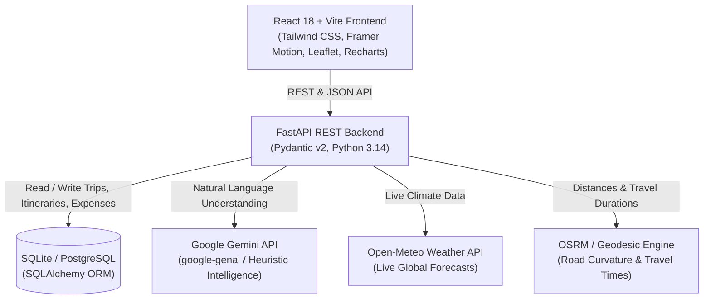

# 🧭 WanderWise – AI-Powered Smart Travel Planner

[](https://fastapi.tiangolo.com)
[](https://vitejs.dev)
[](https://tailwindcss.com)
[](https://leafletjs.com)
[](LICENSE)

> A modern, responsive, full-stack AI travel copilot and trip orchestrator combining personal travel assistance, intelligent day-by-day itinerary structuring, interactive routing maps, live weather dynamic replanning, group expense splitting, and what-if simulation.

---

## 📸 Key Features & Capabilities

### 1. 🤖 Conversational AI Travel Copilot
- **Natural Language Understanding & Multi-turn Context:** Understands travel queries conversationally ("I want to travel somewhere peaceful for 4 days with ₹15,000 budget and 3 friends").
- **Structured AI Responses:** Rather than returning raw markdown walls, the copilot generates actionable structured preview cards (destination cards with photos, day-by-day previews, budget summaries, and one-tap action chips).
- **Conversational Trip Modifications:** Request changes in chat ("Make day 2 less hectic", "Remove the museum", "Add a sunset viewpoint") and watch the itinerary and map recalculate in real time.
- **Gemini API Integration:** Built with Google Gemini API support with an expert built-in travel intelligence fallback when offline or without an API key.

### 2. 🗺️ Smart Itinerary Generator & Interactive Map
- **Clustered Day-Wise Schedule:** Generates morning, afternoon, and evening activities with minimal backtracking and realistic travel durations.
- **Leaflet & OpenStreetMap Engine:** Interactive route map with numbered custom pins, categories (nature, culture, food, photo, adventure), connecting polylines, and distance calculations via OSRM / Geodesic road models.
- **Full Customization:** Add custom activities, edit timings, delete stops, and reorder activities.

### 3. 🌦️ Weather-Based Dynamic Replanning
- **Live Open-Meteo API:** Zero-cost, live global forecasts including temperature, rain probability, wind speeds, and travel tips.
- **Rainy-Day Adaptive Swaps:** If rain strikes, one-click replanning identifies outdoor viewpoints/treks and swaps them with sheltered indoor tea museums, artisanal roast lounges, and covered craft bazaars.

### 4. 💰 Smart Budget Planner & Itemized Expense Tracker
- **7-Category Breakdown:** Transportation (28%), Accommodation (32%), Food (20%), Activities (10%), Shopping (5%), and Emergency Reserve (5%).
- **Interactive Visualizations:** Recharts bar charts (Allocated vs. Actual spent) and pie charts with budget alerts.
- **Expense Logging & Receipts:** Log itemized receipts with payer attribution.

### 5. 👥 Group Travel Planner & Expense Splitter
- **Collaborative Trips:** Generate unique invite codes (e.g. `MUNNAR26`) and invite friends via link.
- **Consensus Voting:** Upvote and downvote candidate destinations and activities with comment threads.
- **Automated Debt Settlement:** Resolves who owes whom with the minimal number of bank/UPI transfers.

### 6. 🎛️ What-If Trip Simulator
- Test hypothetical trip adjustments (+1 to +4 days, ±₹ budget, transport mode switches between road trip, scenic train, and express air, and extra friends joining).
- Calculates per-person costs and provides feasibility ratings before committing changes.

### 7. 🎒 Intelligent Packing Assistant & 🛡️ Travel Safety
- **Packing Checklist:** Auto-categorized (Clothing, Toiletries, Electronics, Documents, Medicines, Activity essentials) with interactive checkboxes and progress tracking.
- **Safety Directory:** 24/7 verified emergency numbers (Unified Emergency 112, Medical 108, Tourist Police 1363, Women Safety 1091), nearby hospitals, and police stations with distance metrics.

### 8. 💎 Hidden Gems & Mood-Based Exploration
- Discover verified offbeat travel destinations (Chopta, Ziro Valley, Tirthan Valley).
- Mood-based exploration translates emotional desires ("I want to disconnect from everything") into destinations, travel styles, and itineraries.

---

## 🏛️ System Architecture



---

## 🚀 Quickstart & Installation

### Prerequisites
- **Python 3.10+** (Python 3.14 compatible)
- **Node.js v18+** & npm

### 1. Clone & Set Up Backend

```bash
# Navigate to project root
cd chatbot

# Install Python dependencies
python -m pip install -r backend/requirements.txt

# Configure environment variables
copy backend\.env.example backend\.env
```

### 2. Set Up Frontend

```bash
cd frontend
npm install
copy .env.example .env
cd ..
```

### 3. Launch Application

#### Option A: One-Click Windows Launcher
Double-click `run_app.bat` or run:
```cmd
run_app.bat
```

#### Option B: Terminal Commands
**Terminal 1 (Backend):**
```bash
python run_backend.py
# API runs on http://localhost:8000 (Swagger docs: http://localhost:8000/docs)
```

**Terminal 2 (Frontend):**
```bash
npm run dev --prefix frontend
# Web App runs on http://localhost:5173
```

---

## 🔑 Environment Variables Guide

### Backend (`backend/.env`)
| Variable | Description | Default |
| :--- | :--- | :--- |
| `PROJECT_NAME` | Name of the FastAPI application | `"WanderWise API"` |
| `SECRET_KEY` | Secret key for JWT cryptographic signatures | `"wanderwise_super_secret_jwt_key_2026_travel_ai"` |
| `DATABASE_URL` | SQLite / PostgreSQL connection string | `"sqlite:///./wanderwise.db"` |
| `GEMINI_API_KEY` | Optional Google Gemini API Key | `""` (Uses built-in travel intelligence fallback) |
| `GEMINI_MODEL` | Gemini AI model identifier | `"gemini-1.5-flash"` |

### Frontend (`frontend/.env`)
| Variable | Description | Default |
| :--- | :--- | :--- |
| `VITE_API_URL` | Base proxy path for API requests | `"/api/v1"` |

---

## 🧪 Automated Test Suite

WanderWise includes an end-to-end integration test suite verifying all 12 core journeys (trip creation, structured itinerary generation, what-if simulator, budget calculation, weather replanning, group settlement, safety directories, and conversational AI):

```bash
python -u test_direct.py
```

Output:
```
🚀 Running WanderWise Full End-to-End Direct Integration Test Suite...
  ✓ User session active: Aarav Sharma (wanderer@wanderwise.com)
  ✓ Loaded 12 curated destinations
  ✓ Recommendations engine returned top match: Munnar, Kerala (99%)
  ✓ 'Surprise Me' generated: Spiti Valley, Himachal Pradesh
  ✓ Found 3 offbeat hidden gems
  ✓ Trip #8 generated with 3 days and 33 packing items
  ✓ What-If Simulator: 3d -> 5d, Per-Person Cost ₹13,490
  ✓ Logged expense of ₹650.0, Remaining budget: ₹21,350.0
  ✓ Weather replan applied: Day 1 updated for rainy conditions with indoor venues
  ✓ Group member Priya Sen joined. Group settlement engine computed balance.
  ✓ Safety directory loaded: High (Safe for Solo & Family Travelers) with 5 hotlines
  ✓ Toggled packing item to packed status
  ✓ Conversational AI generated structured response with type: destination_list

🎉 ALL 12 CORE WORKFLOWS PASSED WITH 100% SUCCESS!
```

---

## 📡 API Reference Overview

- **Auth:**
  - `POST /api/v1/auth/signup` – Register new user
  - `POST /api/v1/auth/login` – Authenticate user and receive JWT
  - `GET /api/v1/auth/me` – Retrieve active profile
  - `PUT /api/v1/auth/preferences` – Update travel persona and budget tiers

- **Destinations & Discovery:**
  - `GET /api/v1/destinations` – Search and filter destinations
  - `POST /api/v1/destinations/recommend` – Multi-criteria personalized recommendation score
  - `GET /api/v1/destinations/surprise-me` – High-confidence surprise pick
  - `GET /api/v1/destinations/hidden-gems` – Offbeat, verified lesser-known spots
  - `POST /api/v1/destinations/mood-plan` – Emotional mood-to-itinerary translation

- **Trips & Itineraries:**
  - `POST /api/v1/trips` – Auto-generate complete day-by-day trip plan & packing checklist
  - `GET /api/v1/trips` – List user trips by status
  - `GET /api/v1/trips/{id}` – Trip detail with days, activities, members, and expenses
  - `POST /api/v1/trips/{id}/days/{day_id}/activities` – Add custom activity
  - `DELETE /api/v1/trips/activities/{id}` – Remove activity
  - `POST /api/v1/trips/{id}/duplicate` – Duplicate itinerary
  - `POST /api/v1/trips/{id}/simulate` – What-If simulation engine

- **Weather & Routing:**
  - `GET /api/v1/weather` – Live Open-Meteo forecast and advisory
  - `GET /api/v1/weather/route` – Waypoint distance and travel time calculation
  - `POST /api/v1/weather/replan-day` – Rainy-day indoor venue swap

- **Budget & Expenses:**
  - `GET /api/v1/budget/{trip_id}/summary` – 7-category breakdown and spend health alerts
  - `POST /api/v1/budget/{trip_id}/expenses` – Log itemized receipts
  - `DELETE /api/v1/budget/expenses/{id}` – Delete logged receipt

- **Group Travel:**
  - `POST /api/v1/group/{trip_id}/invite` – Add companion by email
  - `POST /api/v1/group/join/{share_code}` – Join trip via code/link
  - `POST /api/v1/group/{trip_id}/votes` – Vote on activity/place consensus
  - `GET /api/v1/group/{trip_id}/settlements` – Minimal transfer settlement calculator

- **Chatbot & Safety:**
  - `POST /api/v1/chat/message` – Conversational AI assistant with structured cards
  - `GET /api/v1/safety/{destination}` – Emergency hotlines, nearest hospitals, and police directories
  - `PUT /api/v1/packing/items/{id}/toggle` – Interactive packing checklist toggle

